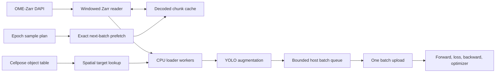

# YOLO training from OME-Zarr

## Decision

Training should reuse Blockflow's storage layer, not its phase executor.

The useful reusable pieces are:

- `AttachedImage` and `Window` for selecting OME-Zarr planes and regions;
- `ZarrEnvironment::read` for typed region reads;
- the shared decoded `ChunkCache` and its hit, miss, eviction, and source-byte
  counters;
- exact region prefetch through `Environment::prefetch`;
- `Region` and `BlockGrid` for crop geometry; and
- the native object table and its spatial index for finding targets.

`PlanBuilder` and `execute_phases` should remain outside the training loop. They
describe an exhaustive, mostly stateless traversal whose tasks may complete in
parallel. Training deliberately revisits and shuffles samples, combines four
unrelated samples for mosaic augmentation, and has a strict dependency from one
optimizer step to the next. Hiding mutable model state inside a `BlockOp` would
make that ordering implicit and would give the scheduler a workload it cannot
represent accurately.



## What exists now

`YOLOv11-rs` now has the source-neutral `SampleStore` interface, a file-backed
store, deterministic D4 augmentation, a bounded ordered worker pool, rolling
prefetch, host collation, and one contiguous image upload per batch.
`train_with_stores` loads initial weights, runs backward per microbatch,
accumulates gradients, flushes the last partial accumulation, evaluates through
the same loader, maintains the reference trainer's parameter and BatchNorm-buffer
EMA on the GPU, and writes EMA-based last and best checkpoints. The CLI exposes
worker and queue counts and uses the standalone LibTorch CUDA feature.

### PyTorch recipe parity

The preloaded Rust and PyTorch benchmarks both default to `0.0001`, the initial
learning rate in `YOLOv11-pt/utils/args.yaml`. A temporary zero-learning-rate
diagnostic was removed because it could hide optimizer-update errors.

The production trainer now also matches the reference recipe in the places
that affect optimization:

- `LinearLR` uses the configured `min_lr`, `max_lr`, warmup epochs, and current
  global microbatch index at each optimizer boundary;
- SGD uses the configured momentum with Nesterov enabled;
- weight decay is scaled by nominal batch size and applies only to convolution
  and linear `weight` parameters, excluding biases and BatchNorm `gamma` and
  `beta`, as Python `set_params` does;
- CIoU's alpha term is detached as it is inside Python's `torch.no_grad` block;
- training uses live BatchNorm statistics, while validation strips autodiff so
  it uses frozen running statistics like `model.eval()`; and
- EMA updates stay on the device and include both parameters and floating
  BatchNorm buffers.

The Burn based YOLO trainer currently uses FP32 and flushes a final partial
gradient accumulation. Those are deliberate trainer semantics; Burn does not
need to reproduce PyTorch's AMP and end-of-epoch behavior. They should still be
recorded in comparisons because they affect memory use, update counts, and the
training trajectory.

Host geometry is now an explicit `--geometry d4|none` option. `none` is the safe
default and supplies a controlled letterbox-only baseline. `d4` is an opt-in
policy for data where orientation should not affect the prediction, such as the
DAPI fluorescence dataset described below.

This choice is specific to the dataset, acquisition setup, task, and intended
generalization target; it is not a hard rule attached to an imaging modality.
DIC and phase contrast contain directional image-formation cues, so rotations
and reflections may be inappropriate when optimizing for one lens and
illumination configuration. The same modalities can still benefit from an
isotropy assumption when training a general classifier intended to work across
orientations or acquisition configurations. Validate the policy on the held-out
distribution the model is meant to serve.

Photometric augmentation is an independent axis. DIC and phase contrast may
still benefit from HSV or other colour and intensity variation while geometry
remains fixed. A future `--photometric` option should expose that choice without
enabling geometry. The translated reference COCO augmentation implementation
remains in the crate, but it is not yet adapted to the source-neutral
multithreaded loader. Adding a reference policy later will allow comparison
without changing the storage interface. Until then, runs must not describe D4
training as reference YOLO augmentation.

The release preloaded benchmark uses normal unfused BatchNorm training, FP32,
batch size 2, 640 by 640 images, 32 targets per image, and the reference initial
learning rate of 0.0001. On the Quadro RTX 5000, median complete step time was
44.58 ms in Rust and 62.34 ms in matched PyTorch FP32, so Rust was **1.40×
faster**. The original trainer's AMP path took 59.39 ms median on this small
batch. Ten timed updates remained finite and the Rust loss decreased from
19.320 to 19.171.

This required native LibTorch convolution, SiLU, softmax, log-softmax, and
training BatchNorm autodiff paths in the local Burn fork. The DFL loss now keeps
its logits on the gradient graph, CIoU matches Python's detached alpha term, and
task assignment stays batched on the GPU. A two-worker end-to-end CUDA smoke
run produced last and best checkpoints plus the epoch CSV.

The OME-Zarr `SampleStore` adapter and object-table bounding-box source remain
to be implemented. The model is a detector with
`(class, cx, cy, width, height)` targets; it does not yet have an instance-mask
head or mask loss.

## Crate boundary

`YOLOv11-rs` must not depend on Blockflow because Blockflow already depends on
`YOLOv11-rs`. Put the generic training interface in `YOLOv11-rs` and the
OME-Zarr implementation in this workspace.

The YOLO crate should expose a source-neutral interface along these lines:

```rust
pub trait SampleStore: Send + Sync {
    fn len(&self) -> usize;
    fn load(&self, key: usize) -> anyhow::Result<RawSample>;
    fn prefetch(&self, keys: &[usize]) -> anyhow::Result<()>;
}

pub struct RawSample {
    pub rgb: Vec<u8>,             // interleaved host bytes
    pub width: usize,
    pub height: usize,
    pub targets: Vec<BoxTarget>,  // pixel coordinates before augmentation
}
```

The current file dataset becomes one `SampleStore`. A local
`OmeZarrSampleStore` becomes another. Resize, mosaic, mixup, geometric and
colour augmentation, collation, and device upload stay in `YOLOv11-rs`, because
their semantics belong to the model and must be identical for file and Zarr
training.

`train_with_stores(config, train, validation, options, device)` is the generic
entry point. The CLI is its file-backed caller. The Blockflow example will call
the same function with OME-backed stores.

## Samples and ownership

Use the same geometry as whole-slide inference:

- a 512 by 512 core determines which cells belong to the sample;
- a 64 pixel halo supplies context;
- the resulting 640 by 640 DAPI crop is the model input without rescaling; and
- a cell is a target when its centroid is inside the core. Its box may extend
  into the halo.

Centroid ownership makes every cell appear once per non-mosaic epoch and avoids
teaching the model from objects arbitrarily cut at adjacent tile boundaries.
Boundary crops are clipped and padded to 640 by 640 by the adapter.

DAPI is read once and replicated into RGB in the host batch buffer. It must not
be attached and decoded as three independent source images. Normalization is a
dataset parameter and should initially use one fixed range for every crop; a
representative starting point for this slide is the 1 to 70 range used by the
StarDist experiment. Per-tile normalization would change the appearance of an
otherwise identical nucleus according to its neighbours.

### Spatial split

Keep the central quarter used for the zero-shot result as a frozen test region.
It must never be sampled for training. Split the outer 75% into spatially
contiguous training and validation macro regions. Randomly splitting adjacent
tiles would leak almost identical halo pixels between sets.

Apply a guard band at least as wide as the 64 pixel input halo around validation
and test regions. A training sample whose 640 pixel input intersects either
region is excluded, even when its 512 pixel ownership core lies outside. This
prevents the model from seeing held-out nuclei as unlabeled halo context.

This evaluates imitation of Cellpose on one slide. It does not establish
generalization to another acquisition; that requires holding out entire slides
once more data is available.

## Augmentation schedule

Augmentation should be part of the epoch sample plan rather than independent
random choices made after a worker receives a crop. That makes every future
read known soon enough to prefetch, gives balanced transform coverage, and lets
a failed epoch be reproduced exactly.

### Orientation

Start with the eight exact square symmetries: four 90 degree rotations, each
with and without a reflection. They need no larger source window, introduce no
interpolation blur, and transform boxes and masks exactly. For tile `i` in
epoch `e`, choose a permutation such as:

```text
orientation = permute(seed, i, e) mod 8
```

with the additional constraint that each tile sees all eight orientations over
eight epochs. The transform runs after the source crop is decoded, so it causes
no extra Zarr reads. Materializing all eight variants in one epoch would make
successive gradients highly correlated and multiply the epoch size without
adding source information; cycling them across epochs gives the coverage at no
I/O cost.

Arbitrary-angle rotation should wait. A 640 pixel square needs about a 906
pixel source square to survive every rotation without padded corners, touches
more chunks, and interpolates small nuclei. Exact right-angle rotations test the
useful invariance first.

### Shifted overlapping windows

Use one globally shifted 512 pixel ownership grid per epoch. Choose the shift
from a small balanced sequence, for example offsets in each axis from
`{0, 128, 256, 384}`. A shifted grid is still a partition: every cell belongs
to exactly one core in that epoch, while its position relative to the 640 pixel
input and the tile boundary changes between epochs. Clip and pad only at slide
edges.

This supplies overlap without multiplying cells within one epoch. Adjacent
shifted windows still share most of their source chunks, so traversing them
within a macro tile keeps the decoded cache hot. The central test region remains
excluded after applying the shift, including its input-halo guard band.

The shift should be selected per epoch, not independently per tile. Independent
crop jitter destroys the regular access pattern, makes gaps and duplicate
ownership likely, and gives the prefetcher a much larger set of unrelated
regions.

### Intensity and scale

The COCO defaults are not appropriate without measurement on DAPI:

- hue and saturation augmentation have no meaning after one grayscale channel
  is replicated to RGB;
- a fixed dataset normalization range should run before augmentation;
- modest brightness, contrast, gamma, noise, and blur can model acquisition
  variation and operate on the already loaded crop; and
- large scale changes risk teaching a false nucleus-size distribution. Start
  with no scale augmentation, then test a narrow range only if held-out results
  show a need.

Mosaic should initially be disabled. It creates artificial tissue seams and
four unrelated density contexts, while shifted overlapping windows already vary
cell placement and context. Mixup should also remain off for the first detector
pilot because overlapping fluorescent nuclei are not a linear mixture of two
different tissue locations. They can be measured later as independent
experiments.

### Relationship to caching

Do not reread a crop for its orientation or intensity transform. Loader workers
decode one raw crop, query its targets once, apply the scheduled host transform,
and place the finished sample in the batch queue. Neighboring crop order, rather
than repeated augmentation of one crop, supplies cache reuse.

The resulting control structure is deliberately small:

```text
EpochSchedule = spatial split
              + global grid shift
              + shuffled macro-tile order
              + within-macro-tile traversal
              + per-tile orientation/intensity seed
```

This is enough planning for training. It is a list of reads and transformations,
not a Blockflow compute DAG or cost search. Its output feeds the existing exact
prefetcher one batch ahead.

## Targets from Cellpose

The native Cellpose table already supplies stable IDs, centroids, area, and a
spatial index, but the published 2079 table has no bounding-box columns. YOLO
detection needs at least:

- `bbox_min_y`, `bbox_min_x` (inclusive), and
- `bbox_max_y`, `bbox_max_x` (exclusive).

These are ordinary object-table columns; the format needs no special YOLO
extension. New Cellpose and StarDist runs should accumulate them during the
existing per-object voxel scan. For the current annotation, run a one-time
Blockflow reduction over `labels/cellpose-dapi/0` and join the four columns by
`label_id`. Cellpose inference does not need to be repeated.

For this slide, loading the needed columns for all 490,366 cells costs only a
few tens of MiB and is simpler than issuing a table query per sample. The
general adapter should also support partial reads through the table's 1024
pixel spatial index, with a small cache of decoded target tiles.

The first model should be a one-class detector trained from these boxes. It is
a fast go/no-go experiment for localization and counting. It cannot reproduce
Cellpose boundaries. A comparable segmentation annotation requires a YOLO
segmentation head, mask loss, mask-aware NMS, and label-image publication. The
label Zarr can provide mask targets directly for each crop when that phase is
implemented; polygons do not need to be materialized first.

## Epoch plan and cache policy

Uniformly shuffling 512 pixel cores is hostile to the source chunk grid. A
haloed sample commonly touches a three by three neighbourhood of 512 pixel
chunks, and an adjacent sample reuses most of it. A global random permutation
throws that reuse away.

Build each epoch as follows:

1. Divide the allowed area into macro tiles, initially 8 by 8 sample cores.
2. Shuffle macro tiles using the epoch seed.
3. Keep two to four macro tiles active and take samples round-robin from their
   local Morton or row-major traversals. This gives a batch spatial diversity
   without abandoning chunk locality.
4. Assign balanced orientation and intensity transforms from the same seed,
   before loading starts. Mosaic partner keys are added only if a later
   experiment enables mosaic.
5. Prefetch only the regions needed by the next host batch.

This preserves epoch-level shuffling while retaining storage locality over a
small window. Cell occupancy can bias sampling toward populated cores while a
configurable fraction of empty cores supplies negative examples. Record the
sample keys and seed so a failed run and a benchmark can be replayed exactly.

Use one shared decoded `ChunkCache` across all loader workers. Start with:

- two to four CPU loader workers;
- one-batch prefetch lookahead;
- a two-batch bounded prepared queue; and
- an explicit cache limit of 256 to 512 MiB.

The right values are measurements, not constants. Report decoded and encoded
hits, misses, evictions, source bytes, prefetches used, and prefetches wasted.
Sweep macro-tile size, worker count, lookahead, and cache capacity on a fixed
sample sequence. The useful outcome is low optimizer data-wait time without
increasing total wall time or host RSS materially.

The existing prefetcher is suitable because the full next-batch access list is
known. Cancellation also applies when an epoch stops early. The full
Blockflow task scheduler adds no value here: the bounded host queue already
expresses the only concurrency training needs between storage and the GPU.

## GPU training path

The first-class `libtorch` feature in `YOLOv11-rs` is the training backend. The
CubeCL feature remains available, but direct convolution is not the performance
baseline on this GPU.

The preloaded release comparison uses an already resident realistic batch:

1. forward, loss, backward, and optimizer step in Rust LibTorch; and
2. the identical model, precision, batch, and targets in original PyTorch.

The benchmark reports forward, loss, backward, optimizer, and complete step
time. Matched FP32 is the primary ratio. PyTorch AMP is recorded separately
because the Rust path does not yet expose autocast and loss scaling.

The training loop now includes:

- load the requested initial checkpoint;
- prepare a whole host batch before creating device tensors;
- perform one image upload and one target upload per batch;
- run backward per microbatch and accumulate gradients rather than retaining
  several complete autodiff graphs;
- step on the intended accumulation boundary and flush the final partial
  accumulation; and
- read progress scalars at a lower cadence so logging does not synchronize
  every step unnecessarily.

## Implementation order

1. **Completed: compute baseline in `YOLOv11-rs`.** LibTorch training,
   checkpoint loading, the preloaded-step benchmark, and the matched Python
   benchmark are implemented.
2. **Completed: separate storage from augmentation.** `SampleStore`, host
   `RawSample`, loader workers, bounded batches, one batched upload, and the
   file-backed implementation are in place.
3. **Prepare targets once.** Add bounding-box columns to future instance tables
   and generate them for the existing Cellpose labels without rerunning
   Cellpose.
4. **Add `OmeZarrSampleStore`.** Reuse windowed reads, cache, prefetch, block
   geometry, and the object table. Preserve the central quarter as test data.
5. **Prove the path on a tiny set.** Overfit 32 to 64 tiles until loss and
   training error fall sharply. This catches target-coordinate, channel-order,
   normalization, and checkpoint-loading errors cheaply.
6. **Run the detector pilot.** Train on the outer slide, select on the spatial
   validation region, and evaluate once on the frozen central quarter against
   the recorded 323,028 Cellpose objects.
7. **Decide on masks.** Continue to a YOLO segmentation head only if detector
   recall, crowded-cell separation, and runtime justify the larger change.

## Acceptance measurements

The workflow is ready for a long training run when all of these are recorded:

- a 32 to 64 tile overfit succeeds;
- file-backed and OME-backed stores produce identical unaugmented samples for
  a converted fixture;
- Rust and Python preloaded training-step timings use the same precision and
  batch size;
- optimizer data-wait time, cache counters, prefetch waste, wall time, host RSS,
  and peak device memory are reported for the OME path; and
- a deterministic epoch can be replayed from its sample plan and seed.

The long-run quality report should give object precision and recall, centre and
box agreement, duplicate rate across tile seams, and throughput. Pixel or
instance-mask metrics become meaningful only after a segmentation head exists.
