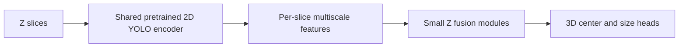

# Reusing the 2D microscopy YOLO model for 3D detection

The previous 2D microscopy model can help the 3D detector, but the current
YOLO3D model cannot load its checkpoint directly.

## How similar are the models?

They share the broad idea of multiscale convolutional detection, but their
implementations differ substantially.

| Component | 2D model | Current 3D model |
|---|---|---|
| Backbone | YOLOv11 DarkNet style backbone | Small sequential Conv3D backbone |
| Feature fusion | DarkFPN neck | No comparable FPN |
| Detection scales | P3/P4/P5 | P2/P3/P4 |
| Output | 2D class and DFL box predictions | 3D center heatmap, offset, size and quality |
| Convolutions | `Conv2d` | Anisotropic `Conv3d` |
| Normalization | YOLOv11 normalization | GroupNorm |
| Primary objective | Bounding boxes | Cell centers with approximate 3D extents |

The current 3D network was inspired by the 2D workflow, but it is closer to a
small CenterNet-style 3D detector than a literal 3D YOLOv11. Layer names,
channel sizes, kernels and heads differ, so the existing 2D checkpoint is not
directly compatible.

## Can the current 3D model train on 2D images?

Technically, yes. A 2D image can be represented as a volume of depth one, and
2D boxes can become center and XY-size targets.

That would train the XY parts of the filters, but it has limitations:

- It provides no real information about variation along Z.
- Layers with `3 x 3 x 3` kernels would only train their center Z plane.
- It would not reuse the already successful 2D YOLO checkpoint.
- Repeated slices would teach artificial constancy through Z.

It could serve as simple pretraining, but it should not be the main strategy.

## Recommended design: shared 2D encoder with 3D fusion

Build the next 3D detector around the previous fine-tuned 2D model:



For each Z slice:

1. Run the same pretrained 2D backbone and feature pyramid.
2. Stack its feature maps along Z.
3. Fuse adjacent slices using small `3 x 1 x 1` or anisotropic 3D blocks.
4. Train new 3D center, offset, size and confidence heads.

This allows us to reuse most of what the 2D model learned about DAPI nuclei.
Only the Z fusion and 3D output heads need to learn from the limited 3D
annotation.

### Training stages

1. Load the previously fine-tuned 2D DAPI checkpoint.
2. Freeze the 2D encoder.
3. Train the Z fusion and 3D heads on the PBMC volume.
4. Unfreeze the upper encoder stages with a lower learning rate.
5. Retain a 2D auxiliary loss on existing 2D data if needed to prevent the
   encoder from forgetting its useful features.

The 2D and 3D datasets can therefore be used together:

- 2D samples update the shared encoder and existing 2D head.
- 3D samples update the shared encoder, Z fusion and 3D head.
- Initially, only the new 3D components need to move substantially.

## Input-channel handling

If the earlier 2D DAPI model received grayscale copied into RGB, its first
convolution can be converted exactly to one channel by summing the three
input-channel kernels. This preserves the activation produced by three
identical input channels.

## One architectural concern

The earlier model uses P3/P4/P5, while densely packed small cells may benefit
from P2. We can expose an earlier backbone feature as P2 and give it a newly
initialized adapter. The established P3/P4/P5 weights would still transfer.

## Recommendation

Keep the present scratch-trained Conv3D model as the baseline and add a second
architecture:

**Pretrained 2D DAPI backbone + lightweight Z fusion + 3D center head.**

This is likely the best use of the available training data. It reuses the
previous 2D model directly, permits continued training with 2D images, and
leaves relatively few new parameters that must be learned from the single
annotated 3D volume.

## Implementation and first PBMC result

The implemented model is named **YOLO-SliceFuse3D**. It reuses the complete
P3/P4/P5 feature path from the epoch-80 2D DAPI YOLOv11-n checkpoint, keeps
that path frozen, stacks the per-slice features along Z, and adds residual
`3 x 1 x 1` fusion blocks plus new 3D center heads.

The first leakage-safe PBMC run selected its first epoch. Additional training
at learning rates `1e-3` and `1e-4` reduced validation AP, so it was stopped
rather than fitting the single volume further. The selected checkpoint reached
center AP 0.6469 on validation and 0.6261 on the frozen test partition. At the
validation-selected threshold, full-volume CUDA inference produced 159 centers
in 149.718 application seconds and 2:29.94 wall time.

The viewer-loadable result is stored at:

```text
/husky/otherdataset/teresa/single/clustered-pbmcs.ome.zarr/
  0/tables/yolo-slicefuse3d-cell-centers-v1
```

The count is above the manual whole-volume estimate of roughly 77--90 cells.
This layer deliberately uses the validation-selected high-recall threshold and
should be reviewed for false positives as well as recovered cells missed by the
native YOLO3D model.

A release `newvolim-server` run discovered this as a reviewable 3D object layer.
A full-volume viewport query returned all 159 rows with `tooDense=false`.
