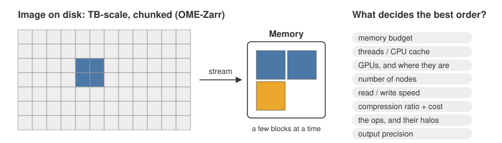
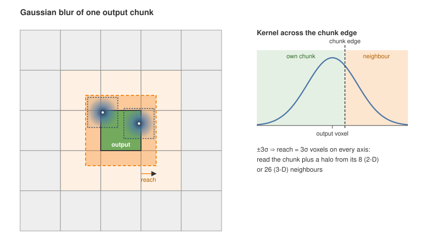
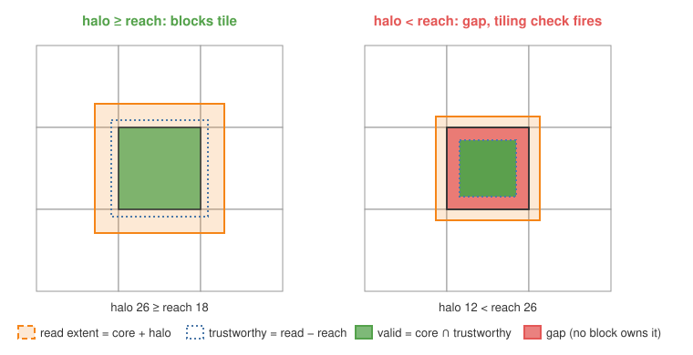
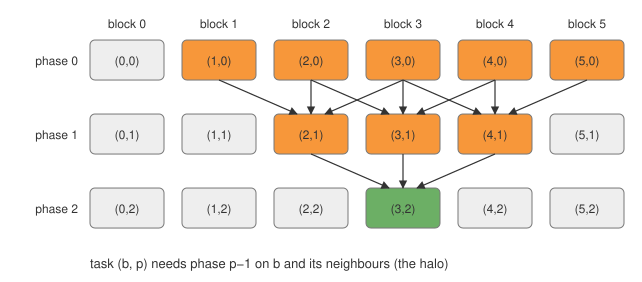
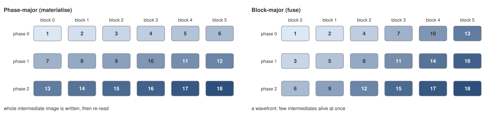
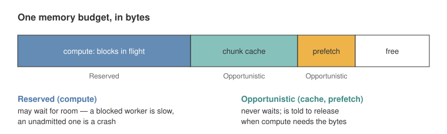
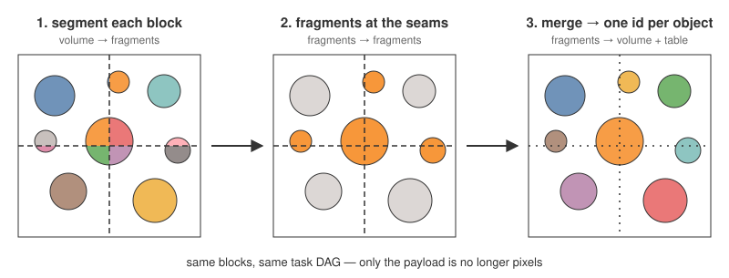

<!--
Figures: SVGs in figures/ are generated by figures/make_figures.py (edit and
rerun, or edit the SVGs in Inkscape). Diagrams marked "mermaid" are inline.
-->

## The problem {#problem}

{fig-align="center" width="100%"}

- Images are TBs; memory holds a few blocks
- The best compute order depends on the machine *and* the pipeline — hard (likely NP-hard)

## Chunks are not independent {#gaussian}

{fig-align="center" width="85%"}

- A voxel near the edge needs voxels from the neighbouring chunks
- So computing one output chunk means reading it **plus a halo** around it
- Every op declares this distance: its **reach**

## Workflow → plan → execute {#overview}

```{mermaid}
%%| fig-width: 11
%%{init: {"themeVariables": {"fontFamily": "Arial, Helvetica, sans-serif"}, "flowchart": {"htmlLabels": false}}}%%
flowchart LR
  W["Workflow
chain of ops"] --> D["decompose
(binding)
blocks, halos, phases"]
  D --> G["Task graph
(block, phase)"]
  G --> R["run
(dynamic)
order, threads, cache,
prefetch, placement"]
  R --> S[("OME-Zarr
output")]
  R -. "timings" .-> ST["Statistics
cost per unit"]
  ST -. "calibrates" .-> D
  ST -. "calibrates" .-> R
```

- **Binding** half: deterministic, data-blind, hashable — decides the answer
- **Dynamic** half: greedy, adaptive — only decides the speed. *Wrong means slow, never wrong.*

## A pipeline is a chain of ops, cut into phases {#chain}

```{mermaid}
%%| fig-width: 11
%%{init: {"themeVariables": {"fontFamily": "Arial, Helvetica, sans-serif"}, "flowchart": {"htmlLabels": false}}}%%
flowchart LR
  I0[("image 0
input")] --> P0
  subgraph P0["phase 0"]
    A[median] --> B[gaussian]
  end
  P0 --> I1[("image 1")]
  I1 --> P1
  subgraph P1["phase 1"]
    direction LR
    C1[threshold A] --> CMB{{combine: or}}
    C2[threshold B] --> CMB
  end
  P1 --> I2[("image 2")]
  I2 --> P2["phase 2
label + measure"]
  P2 --> I3[("labels + table")]
```

- Ops declare **reach** (how far they look), cost, dtypes — `Sequence`, `Parallel`, `Alternative`
- A phase boundary may live in memory or in storage — the planner's choice

## Blocks, halos and reach {#halo}

{fig-align="center" width="85%"}

- Valid region is **derived from reach**, so the tiling check is a real guard
- Too little halo → gap → caught. Too much halo → only slower

## The unit of work: (block, phase) {#taskgraph}

{fig-align="center" width="85%"}

- Thousands of tasks, explicit dependencies
- Same graph runs on 1 thread, 64 threads, or 20 nodes

## Fuse or materialise is just a walk order {#orders}

{fig-align="center" width="100%"}

- Not baked into the executor — a scheduling **priority**, chosen per run
- Trade-off: re-reading intermediates vs recomputing halos vs memory held

## Pricing a plan before running it {#cost}

```{mermaid}
%%| fig-width: 11
%%{init: {"themeVariables": {"fontFamily": "Arial, Helvetica, sans-serif"}, "flowchart": {"htmlLabels": false}}}%%
flowchart LR
  OP["ops declare cost
per voxel (units)"] --> M["cost model
units × ns/unit"]
  ST["Statistics
measured on this machine"] --> M
  M --> PL["planner
block size, order, fusion"]
  PL --> SIM["simulator / accounting env
prices a plan, moves no bytes"]
  SIM --> PL
  PL --> EX["execute"]
  EX -- "every op and IO timed" --> ST
```

- Like a database query planner: statistics from real runs feed back
- Simulator **ranks** plans; scenarios test the planner on machines you don't have

## One memory budget {#budget}

{fig-align="center" width="90%"}

- Concurrency falls out of the byte budget, not a thread count
- Prefetcher reads the plan — a scheduler, not a predictor

## Objects that cross block seams {#fragments}

{fig-align="center" width="100%"}

- Segmentation (StarDist, Cellpose, YOLO, watershed) → one label image + one object table
- Global IDs survive, so later per-channel measurements link back

## Scaling out {#distributed}

```{mermaid}
%%| fig-width: 11
%%{init: {"themeVariables": {"fontFamily": "Arial, Helvetica, sans-serif"}, "flowchart": {"htmlLabels": false}}}%%
flowchart TB
  C["coordinator
task DAG + claims"]
  W1["worker 1
own cache + budget"]
  W2["worker 2
own cache + budget"]
  W3["worker N
own cache + budget"]
  Z[("shared storage
OME-Zarr chunks")]
  C -- "nearest unclaimed task
(workers pull)" --> W1
  C --> W2
  C --> W3
  W1 <--> Z
  W2 <--> Z
  W3 <--> Z
```

- Tasks never need a peer's memory — they read storage; coordination is metadata only
- Pull + locality bias: workers grow compact regions; empty regions don't unbalance
- Output is byte-identical to a single-node run
